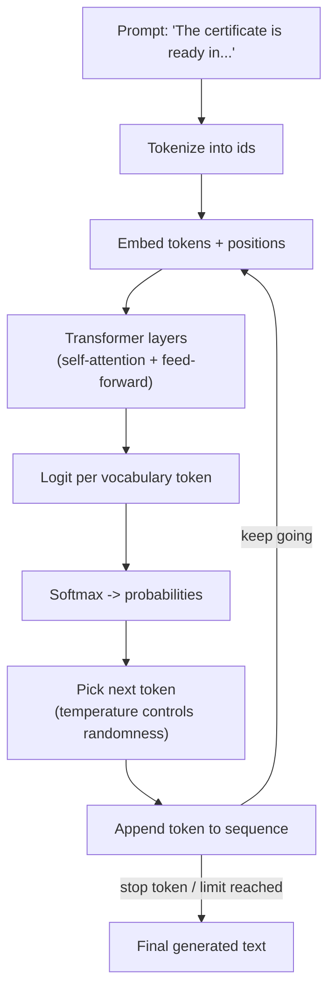

# How LLMs Work

An LLM is, at its core, a machine that guesses the next piece of text. Given
everything written so far, it scores every possible next token (roughly a word
or word-fragment) and picks one. Do that over and over and you get paragraphs
of fluent language. That single trick — next-token prediction — is the whole
engine. Everything else is scale, data, and training.

## Training: learning by being wrong a trillion times

Take a huge pile of text — books, code, web pages — chop it into tokens, and at
every position ask the model "what comes next?". Before it has learned anything
it is essentially random. Each wrong guess produces an error signal: how
*surprised* it was by the real next token. That signal nudges the model's
parameters — billions of numbers — so that next time it would be a little less
surprised. Repeat this trillions of times across trillions of tokens and the
parameters settle into a configuration that captures the statistical structure
of language, and a surprising amount of world knowledge along with it.

The model never reads the training text back like a database. The text is gone;
what stays is a compressed set of weights that encode *patterns*. This is why an
LLM can talk about things it was trained on without storing the original
sentences — and also why it can hallucinate. It generates what is statistically
plausible, not what is filed away.

## Inference: the same loop, one token at a time

When you send a prompt, four things happen:

1. **Tokenize** — the text is split into tokens, each mapped to an integer id.
2. **Embed** — each id becomes a vector (a list of numbers) encoding its meaning,
   plus a position so the model knows order.
3. **Transform** — the vectors pass through many transformer layers. The key
   mechanism is *self-attention*: every token gets to look at every other token
   and decide how much each one matters to it. That is how the model connects a
   pronoun to the noun it refers to, or a question word to the concept it asks
   about.
4. **Predict** — the final layer produces a score (a logit) for every token in
   the vocabulary; softmax turns those into probabilities. The model picks the
   next token — greedily, or with some randomness controlled by *temperature* —
   appends it, and feeds the whole sequence back in for the next round.

The diagram below shows that loop. "Keep going" is why an LLM writes left to
right and cannot easily go back and revise — each token is committed before the
next is chosen.

## The vocabulary that matters

- **Tokens** — the atomic units; not quite words. "certificate" might be one
  token, "unbelievable" might be three.
- **Parameters** — the learned numbers. More parameters means more capacity to
  represent patterns, but also more compute and data needed to train well.
- **Context window** — how many tokens the model can hold at once. Beyond it,
  earlier text falls out of view.
- **Temperature** — how random the pick is. Zero means always the most likely
  token (deterministic); higher means more varied, more creative, more prone to
  drifting.
- **Attention** — the mechanism that lets tokens weigh each other. It is the
  "T" in GPT-style models and the reason they handle long-range dependencies
  better than older recurrent networks.

## Why it feels like reasoning

It is not retrieving answers; it is completing patterns. A well-trained model
has seen so many examples of "question then answer", "code then comment",
"premise then conclusion" that completing a new prompt in the same shape looks a
lot like reasoning. It breaks down because the pattern it completes is not
grounded in the specific facts of your case — which is exactly why tools,
retrieval, and verification matter when correctness counts.
